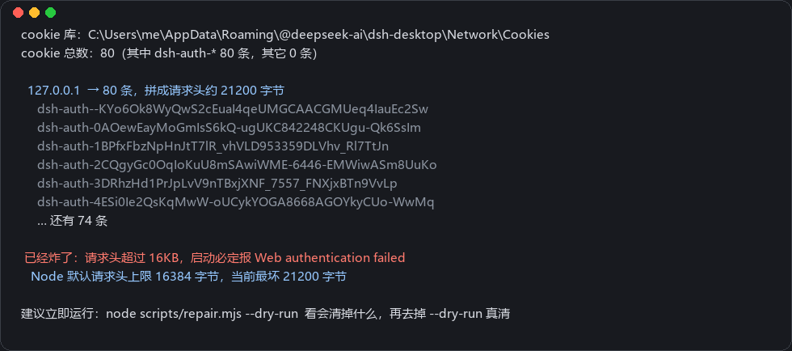

# dsh-cookie-doctor

治好 DeepSeek Harness 桌面版「**桌面版重启若干次后必定启动失败，报 `desktop welcome: Web authentication failed`**」的那个 bug —— 不用重装、不用禁用插件，也不会再复发。

> 症状：桌面版重启 N 次后（实测第 73 次）必定起不来，弹窗建议重装或禁用插件。
> 手动修法是把 `%APPDATA%\@deepseek-ai\dsh-desktop\Network\Cookies` 删掉，但重启几十次后又会犯。
> 截至 `0.2.1-rc.3` 官方仍未修复。

<p>
  
</p>

## 真因

`sessions cookie` 的名字里带了端口，而 cookie 本身不按端口隔离。

`@deepseek-ai/dsh-client-connection` 里是这么算 cookie 名的：

```js
const COOKIE_PREFIX = "dsh-auth-";
/** Canonical request authority used as the cookie name and signed audience. */
function cookieName(authority) {
    return COOKIE_PREFIX + encodeBase64Url(createHash("sha256").update(authority).digest());
}
```

而 `authority` 来自请求头里的 `host`：

```js
function requestAudience(headers, secure) {
    const host = header(headers, "host");          // "127.0.0.1:54321"
    ...
    const url = new URL(`${secure ? "https:" : "http:"}//${host}`);
    return secure ? url.origin : url.host;         // ← TLS 监听用 origin
}
```

桌面版每次启动都随机换端口，于是：

1. 每次启动都算出一个**新的 cookie 名**（`dsh-auth-` + host:端口 的哈希）；
2. Chromium 存 cookie 不看端口，这些 cookie 全都堆在 `127.0.0.1` 这同一个域下；
3. shell 的 welcome backend 会把库里该域下的**所有** cookie 拼成一个 `Cookie` 头发出去：

   ```js
   async () => (await session.defaultSession.cookies.get({ url: ready.url }))
       .map((cookie) => `${cookie.name}=${cookie.value}`).join("; ")
   ```

4. 每条这种 cookie 大约 220~260 字节，攒到 **70 条出头**就顶到 Node 默认的 `maxHeaderSize`（16384 字节）；
5. Node 的 HTTP 解析器在进入业务代码之前就直接返回 **431**，Electron 那边看到的就是认证失败。

实测（见 `test/simulate.mjs` 场景 A）：**第 73 次启动时请求头 16423 字节，431**。和「攒到 70 条」的现象完全对得上。

## 这个插件做了什么

插件挂在 host 进程里，接管 `dsh-host-webserver` 创建的那个 `http.Server`：

| 动作 | 作用 |
|---|---|
| `server.maxHeaderSize = 256KB` | 把天花板抬到 ~1000 条 cookie，**已经攒了 70+ 条的机器也能立刻启动** |
| 每条请求都算一遍「本轮该有的 cookie 名」，把**其它** `dsh-auth-*` 用 `Set-Cookie: …=; Max-Age=0` 过期掉 | Chromium 自己清理，库里永远只剩 1 条，**不再堆积** |
| 统计写进 `~/.dsh/cookie-doctor/report.json` | 能直接看到到底有没有生效 |

关键点：它**不改 DSH 的鉴权逻辑**，也不改端口、不碰 host 头。cookie 名照旧按 `host:port` 哈希，
插件只是把这个 session 用不到的历史 cookie 一条条作废。过期指令走的是同一条 Chromium 网络栈，
所以和当初写下它们的通道完全一致。

实测（`test/simulate.mjs`）：

| 场景 | 结果 |
|---|---|
| A. 不装插件 | 第 73 次启动 431 崩溃 |
| B. 装插件，从零开始 90 次启动 | Cookie 头恒为 **223 字节 / 1 条** |
| C. 装插件，机器已攒 76 条（请求头 17098 字节，已超默认上限） | **不崩，第一次请求就自愈到 1 条** |

另外这个插件在真实的 DSH host 里跑过：`dsh --profile ctest --port 18099` 起来后，
带 20000 字节 `Cookie` 头发请求，返回 **401 而不是 431**，响应里带上了过期指令。

## 安装

```bash
node scripts/install.mjs            # 装进 ~/.dsh/profiles/desktop
node scripts/install.mjs --dry-run  # 先看它要干什么
```

脚本做的事（不需要联网、不需要 pnpm）：

1. `~/.dsh/plugins/dsh-cookie-doctor` → 指向本仓库（Windows 用 junction，不用管理员权限）
2. `<profile>/node_modules/dsh-cookie-doctor` → 指向上面的目录，让 Node 能解析到
3. 在 profile 的 `package.json` 里加上 `dependencies` 和 `dsh.profile.bundles`
   （改之前自动备份，写完回读校验，对不上就自动还原）

> 脚本直接改写 profile 的 `package.json`，因为要保证不依赖 pnpm / 联网。
> DSH 自带的插件管理器是同一份记录的正主；之后若用它装卸插件，以管理器显示的状态为准。
> 读文件时会去掉 UTF-8 BOM（PowerShell / 记事本存过的文件也能正常处理）。

然后**重启 DeepSeek Harness**。控制台会打印一行：

```
[cookie-doctor] 已接管 host HTTP 通道：maxHeaderSize 16384 → 262144，过期策略 开启
```

卸载：`node scripts/install.mjs --uninstall`

## 已经起不来了怎么办

插件只能在 host 起来之后才跑；当请求头已经超过 16KB 时 host 根本收不到请求，
所以**已经病发的机器得先在外面清一次**：

```bash
# 1. 完全退出 DeepSeek Harness（连托盘一起退）
node scripts/diagnose.mjs             # 先体检：会看到 dsh-auth-* 有几十条
node scripts/repair.mjs --dry-run     # 看会删多少（不改任何数据）
node scripts/repair.mjs               # 交互终端里会问一次，答 y 才真删
node scripts/repair.mjs --yes         # 非交互环境（脚本/CI）必须显式加 --yes
# 2. 重新启动 DSH
```

`repair.mjs` 只删 `dsh-auth-*` 那些行，别的 cookie 一条不动 —— 比网上流传的「整个 Cookies 文件删掉」温和得多。
删之前会自动生成 `Cookies.bak-<时间戳>`。

如果只想留下最新那条（比如怀疑里面有当前会话的凭证）：

```bash
node scripts/repair.mjs --keep-latest --yes
```

它按 `creation_utc`（创建时间）挑最新的一条保留，其余删掉。

如果连 DSH 都启动不了、只想手动来：删掉
`%APPDATA%\@deepseek-ai\dsh-desktop\Network\Cookies` 和同目录的 `Cookies-journal` 即可，效果等价，但会连别的 cookie 一起清掉。

## 体检脚本

```bash
node scripts/diagnose.mjs          # 看当前堆了多少、会不会炸
node scripts/diagnose.mjs --json   # 机器可读
```

输出示例：

```
cookie 库：C:\Users\me\AppData\Roaming\@deepseek-ai\dsh-desktop\Network\Cookies
cookie 总数：80（其中 dsh-auth-* 80 条，其它 0 条）

  127.0.0.1  → 80 条，拼成请求头约 20400 字节
     dsh-auth-Ab3x…
     …

🔴 已经炸了：请求头超过 16KB，启动必定报 Web authentication failed
   Node 默认请求头上限 16384 字节，当前最坏 20400 字节
```

> DSH 运行中 cookie 库被 Chromium 独占锁定，体检和修复都要先完全退出 DSH。
> 只想看一眼的话，可以先复制一份库文件再用 `--db <副本>` 分析。

## 配置

改 `cordis.patch.yml` 里的 `config`（或 profile 层覆写）：

| 键 | 默认 | 说明 |
|---|---|---|
| `maxHeaderBytes` | `262144` | 抬到多少。`0` = 不动默认值（不推荐，默认值就是那个坑） |
| `purgeStale` | `true` | 是否过期掉历史 cookie |
| `maxPurgePerResponse` | `200` | 一条响应最多带多少条过期指令 |
| `warnAuthCookies` | `8` | 超过这么多条就警告一次 |
| `reportPath` | `$DSH_HOME/cookie-doctor/report.json` | 统计落盘位置 |
| `quiet` | `false` | 关掉日志 |

这个插件不引入 schemastery（保持「零依赖」），所以没有 Config schema，
校验在 `readOptions()` 里自己做：**拼错的键名、写错的类型都会打一条 warn 并回落默认值**，
不再静默失效。例如 `maxHeaderByte`（少个 s）会报：

```
[cookie-doctor] 未知配置项 maxHeaderByte，已忽略。可用项：maxHeaderBytes, purgeStale, ...
```

## 测试

```bash
node test/simulate.mjs      # 复现故障 + 验证修复（含病发机器自愈、TLS、兜底挂载）
node test/repair.test.mjs   # 体检/修复脚本，用 Chromium 同结构的 cookie 库跑
node test/config.test.mjs   # 配置校验：错键名/错类型必须报出来并回落
```

```
### A. 不装插件（复现线上故障）
  首次：请求头 223 字节，库中 1 条
  末次：请求头 16423 字节，库中 73 条
  ❌ 第 73 次启动失败：auth=303 welcome=431

### B. 装插件（从零开始）
  峰值请求头 223 字节 / 库中 1 条，90 次启动全程正常

### C. 装插件 + 已攒 76 条（病发机器）
  首次：请求头 17098 字节 → 自愈到 1 条，全程正常

### D. HTTPS 监听（cookie 名按 origin 计算）
  4 次启动全程正常，库中稳定 1 条
```

场景 D 专门盯着 TLS 分支：上游在 https 监听下用 `url.origin` 当 authority，
插件如果只会算 `host` 形式，就会把当前会话那条当垃圾删掉。
`simulate.mjs` 里那份上游算法模型必须和 `dsh-client-connection` 保持同步 ——
它写错就会变成「自己跟自己一致」的自证测试。

## 取舍说明

- **抬高 `maxHeaderSize` 有没有副作用？** host 只监听回环地址，抬高上限只是让「头部异常大」的请求
  不至于被解析器直接掐掉；真正的访问控制仍然由 `/api` 的 loopback + Origin 围栏负责。不想要可以设 `maxHeaderBytes: 0`。
- **为什么不干脆把 cookie 名改成不带端口？** 那样 `authority` 就失去了端口绑定（`isAuthenticated` 会校验
  `payload.authority === authority`），等于放宽鉴权语义；而且改的是 DSH 自己的代码，插件做不到、
  也不该越界。这里选择「保留语义，只清理垃圾」。
- 插件对 `apply()` 做了整体 try/catch：即使初始化异常也只会打一行警告，不会让 host 启动失败。

## 更新记录

### v0.1.2

继续收掉审查里剩下的三条（都是「能用但脆」的问题）：

- **不再依赖 `webServer.server` 这个内部字段**。清理改成挂文档化的
  `connection/request` waterfall 事件；拿不到 `http.Server` 时只影响「抬高上限」
  这一项（已经病发的机器），清理照常工作。同时把 server 的查找放宽成按形状匹配，
  并用限时轮询补上 `maxHeaderSize`。
  - 顺带修了一个形状判断的坑：Node 的 `http.Server` 在没配过上限时
    `maxHeaderSize` 是 `undefined`，要求它是 `number` 会永远匹配不上。
- **配置校验**：新增 `test/config.test.mjs`。拼错的键名、写错的类型都会 warn 并回落默认值
  （原来 `purgeStale: "false"` 这种会被静默当成 `true`）。
- **`install.mjs` 改写 profile 的 package.json 后回读校验**，失败自动从备份还原并退出；
  输出里明确它与 DSH 自带插件管理器并存的关系。
- `install.mjs` 修掉两个实际踩到的坑：`readJson` 不认 UTF-8 **BOM**
  （PowerShell / 记事本存过的文件会直接崩栈），现在去 BOM 并给可读的错误提示。
- 测试：`simulate` 新增场景 E（没有 `connection/request` 时走 `http.Server` 兜底），
  并把主路径改成走真实的事件链路。

### v0.1.1

一轮针对实现本身的审查，修掉以下问题（都有回归测试）：

- **TLS 监听下会删掉当前会话的 cookie**。上游 `requestAudience()` 在 TLS 监听时返回
  `url.origin`（带 `https://` 前缀），明文才返回 `url.host`；插件原来只会算 `host` 形式。
  于是 https 部署下算出的 cookie 名永远对不上真实的，每条历史 cookie（包括当前那条）
  都会被判定成垃圾删掉，造成 401 死循环。现在按 `webServer.protocol` 分支，与上游一致。
- **`--keep-latest` 完全不生效**。日志说「保留 1 条」，实际执行的是
  `DELETE ... WHERE name LIKE 'dsh-auth-%'`，无条件全清。现在按名字逐条删。
- **`--keep-latest` 排序字段用错**。注释写 `creation_utc`，代码排的是 `expires_utc`；
  而且 `readCookies()` 的 SELECT 里根本没有 `creation_utc`，排序键恒为 0，留下的是最旧那条。
- **`--yes` 是死参数**。只被解析、从未使用，`node scripts/repair.mjs` 不带确认就直接改库。
  现在：交互终端问一次，非交互环境必须显式 `--yes`（否则 exit 4）。
- **`isSymlink()` 判断错误**。`lstatSync` 成功就返回 `true`，不看类型；
  走复制兜底时卸载会对真实目录 `rmSync(recursive:false)` 抛错。现在按 `isSymbolicLink()` 判断，
  真实目录还要先确认 `package.json` 里是本插件才删。
- 测试补上 `--keep-latest`、无 `--yes` 拒绝、以及 **HTTPS 场景 D**。

### v0.1.0

首个版本。

## License

[MIT](LICENSE)
